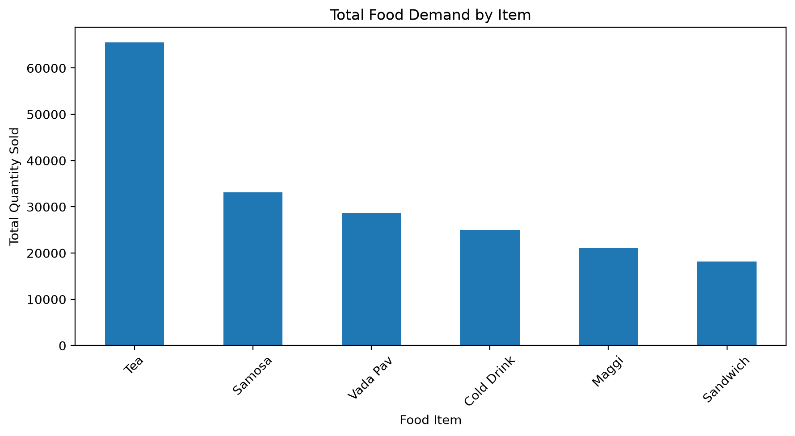
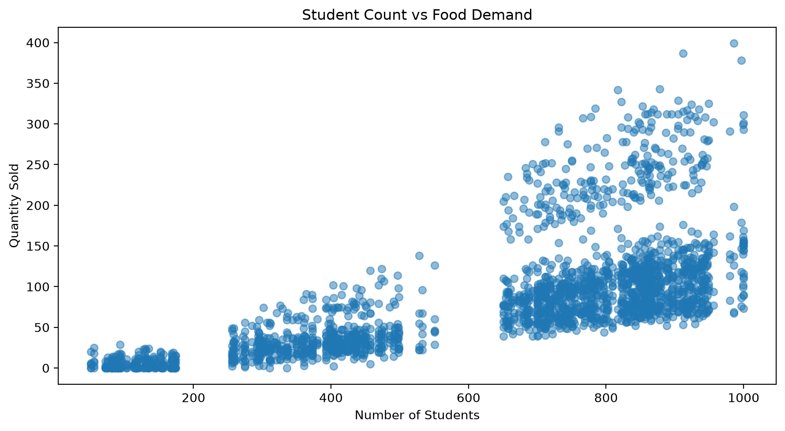
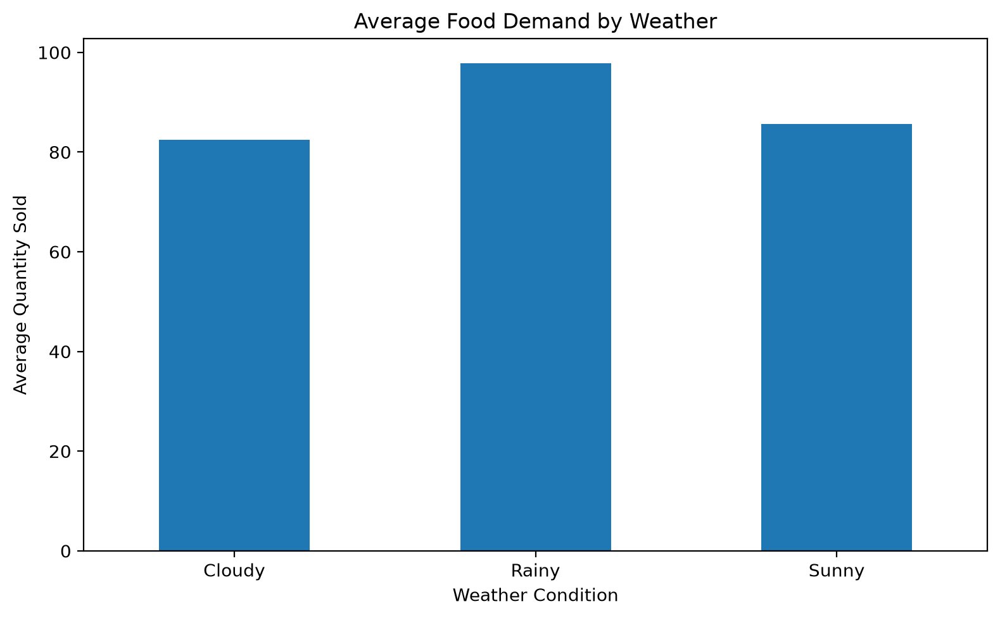
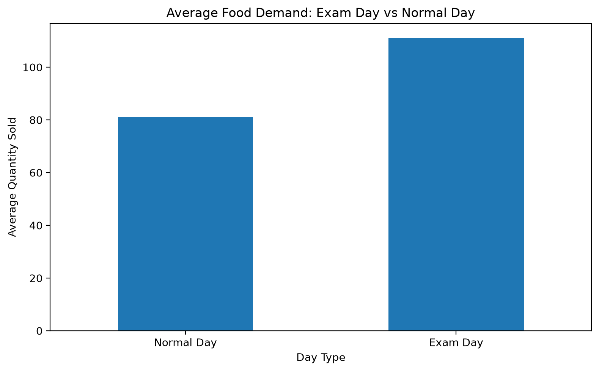
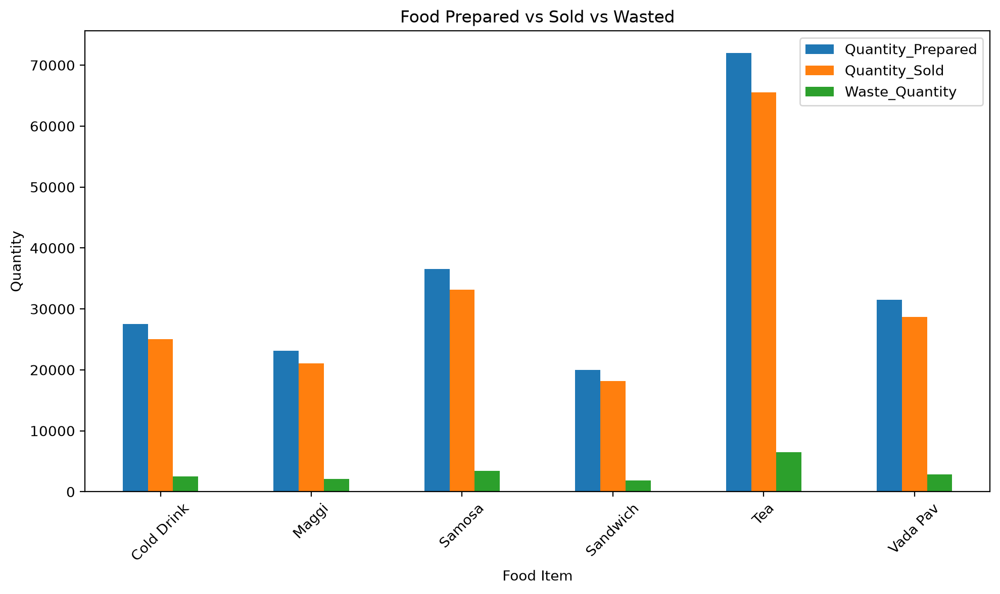
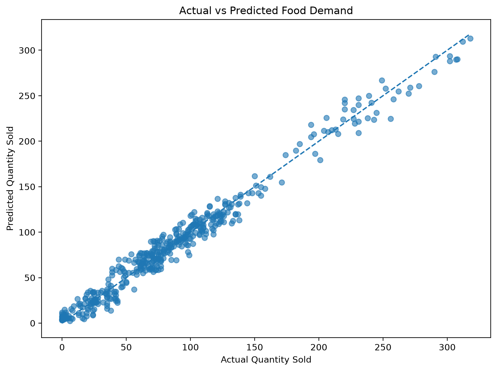
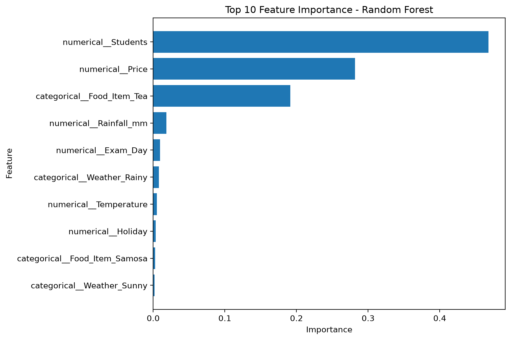

    # SmartCanteen - AI-Powered Food Demand Prediction & Canteen Planning

    SmartCanteen is a Python and Streamlit machine-learning dashboard that helps canteen operators estimate food demand and plan preparation quantities. It combines a trained demand model with manually entered stock levels and historical waste data to provide daily decision support.

    > **Scope:** This is a forecasting and planning dashboard, not an online ordering application. It has no login, payment processing, REST API, database, or real-time inventory integration.

    ## Problem Statement

    Canteens must decide how much food to prepare despite changing attendance, weather, exam schedules, and holidays. Preparing too much can increase waste, while preparing too little can leave demand unmet. SmartCanteen demonstrates how historical sales data and machine learning can support these decisions.

    ## Project Overview

    The Streamlit app has four modules:

    1. **Daily Planner** - Forecasts demand for each food item using the selected date and operating conditions, then compares it with stock entered by the operator.
    2. **Demand Prediction** - Estimates demand for one selected item and displays a preparation recommendation and expected revenue.
    3. **Analytics** - Filters historical data by food item, weather, and exam-day status and presents sales, revenue, and waste summaries.
    4. **Model Information** - Describes the training target, input features, algorithms, and evaluation metrics displayed by the app.

    The application reads `canteen_data.csv` and `demand_model.pkl` from the project root using relative paths.

    ## Forecasting and Daily Planning Workflow

    The model uses these inputs:

    - Day of the week
    - Weather
    - Temperature and rainfall
    - Exam-day and holiday indicators
    - Expected student count
    - Food item and price

    The app constructs a feature row from the operator's inputs and asks the saved scikit-learn pipeline to predict `Quantity_Sold`. In the Daily Planner, it then calculates a safety buffer as 5% of predicted demand, rounded up to a whole unit:

    ```text
    safety_stock = ceil(predicted_demand * 0.05)
    target_stock = predicted_demand + safety_stock
    prepare_now = max(0, target_stock - current_stock)
    ```

    Current stock is entered manually for each item; it is not synchronized with an inventory system. The single-item Demand Prediction page separately recommends preparation as `ceil(predicted_demand * 1.05)`.

    ### Waste-risk analysis

    The Daily Planner derives each item's historical waste rate from the CSV:

    ```text
    historical_waste_rate = total_waste_quantity / total_quantity_prepared * 100
    ```

    It labels risk **HIGH** at 12% or above, **MEDIUM** at 7% or above, and **LOW** below 7%. These are rules applied to the supplied historical data, not a separate predictive waste model.

    ## Dataset

    `canteen_data.csv` contains one row per food item and date in the supplied dataset. Its columns are:

    | Column | Description |
    |---|---|
    | `Date` | Date associated with the record |
    | `Day` | Day of the week |
    | `Weather` | Weather category |
    | `Temperature` | Temperature |
    | `Rainfall_mm` | Rainfall in millimeters |
    | `Exam_Day` | Exam-day indicator |
    | `Holiday` | Holiday indicator |
    | `Students` | Student count |
    | `Food_Item` | Food item |
    | `Price` | Item price |
    | `Quantity_Prepared` | Quantity prepared |
    | `Quantity_Sold` | Quantity sold |
    | `Waste_Quantity` | Quantity not sold |
    | `Revenue` | Revenue for the record |

    **Important limitation:** The included data is synthetic, generated by `generate_dataset.py`; it is not verified real canteen sales or inventory history. Model predictions and analytics should be interpreted as a demonstration, not as validated operational forecasts.

    ## Machine-Learning Training Workflow

    `train_model.py` reads `canteen_data.csv`, predicts `Quantity_Sold`, and uses a 80/20 train/test split. It one-hot encodes the categorical inputs (`Day`, `Weather`, and `Food_Item`) and passes numeric inputs through. It trains and compares:

    - Linear Regression
    - Decision Tree Regressor
    - Random Forest Regressor

    The script selects the model with the lowest Mean Absolute Error (MAE), reports MAE, RMSE, and R-squared, and saves the selected fitted pipeline as `demand_model.pkl`. The app loads this artifact for predictions. No performance guarantee is implied; the supplied dataset is synthetic.

    ## Project Structure

    ```text
    SmartCanteen/
    |-- app.py                         # Streamlit dashboard
    |-- generate_dataset.py            # Generates synthetic canteen_data.csv
    |-- train_model.py                 # Trains, evaluates, and saves demand_model.pkl
    |-- eda.py                         # Exploratory data analysis and plots
    |-- SmartCanteen_Analysis.ipynb     # Data analysis and ML workflow notebook
    |-- canteen_data.csv               # Supplied synthetic dataset
    |-- demand_model.pkl               # Supplied trained model pipeline
    |-- requirements.txt               # Python dependencies
    |-- .gitignore                     # Local/generated file exclusions
    `-- ppt_images/                    # Existing analysis and model charts
    ```

    ## Installation and Setup

    Run all commands from the **project root** (the directory containing `app.py`, `canteen_data.csv`, and `demand_model.pkl`). A Python installation and pip are required.

    On Windows PowerShell:

    ```powershell
    python -m venv .venv
    .venv\Scripts\activate
    pip install -r requirements.txt
    streamlit run app.py
    ```

    The dataset and trained model are already supplied, so dataset generation and model training are optional. Start the app from the project root so its relative data and model paths resolve.

    ## Regenerating the Dataset and Model

    These commands are optional and should also be run from the project root:

    ```powershell
    python generate_dataset.py
    python train_model.py
    ```

    `generate_dataset.py` writes `canteen_data.csv`; running it replaces the supplied dataset. `train_model.py` reads that CSV and writes `demand_model.pkl`, replacing the supplied model. The training script also opens a Matplotlib plot near completion.

    ## Existing Charts

    ### Total food demand by item

    

    ### Student count versus food demand

    

    ### Average food demand by weather

    

    ### Exam day versus normal day demand

    

    ### Prepared, sold, and wasted quantities

    

    ### Actual versus predicted food demand

    

    ### Random Forest feature importance

    

    ## Limitations and Future Improvements

    - The dataset is synthetic; model behavior on real canteen data has not been established.
    - Stock is supplied manually and is not saved to or synchronized with an inventory system.
    - The app does not persist plans, transactions, or orders.
    - There is no user authentication, payment flow, REST API, or database.
    - Training and app behavior depend on compatible Python package versions; dependencies are listed but not version-pinned.
    - Future work could validate forecasts on real, time-ordered sales data; add automated tests and reproducible model evaluation; and, if required, introduce persistent inventory, user access control, and documented deployment configuration.
